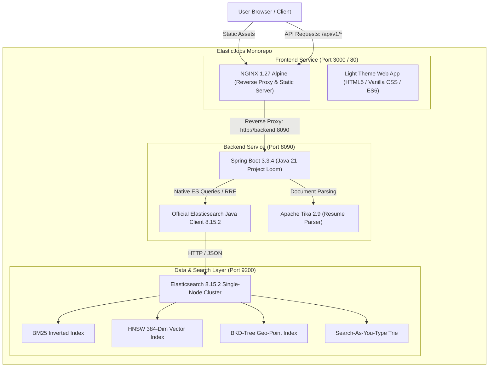

# ElasticJobs Monorepo

> **Production-Grade Job Search Platform** powered 100% natively by **Elasticsearch 8.x**, featuring Hybrid Reciprocal Rank Fusion (RRF), Dense Vector Semantic Search, Typo Tolerance, Geo-Radius Filtering, and a Mobile-First Web Application. Zero relational databases, zero external vector stores.

---

## 🏛️ System Architecture



---

## 📁 Monorepo Layout

```text
.
├── .github/                      # GitHub Standard Configurations & CI/CD
│   ├── workflows/
│   │   ├── ci.yml                # Automated Matrix CI (Java 21 + Node + Docker syntax)
│   │   ├── docker-publish.yml    # Build & publish multi-platform container images to GHCR
│   │   └── codeql.yml            # CodeQL Static Application Security Testing (SAST)
│   ├── ISSUE_TEMPLATE/           # Standardized GitHub Issue Templates
│   │   ├── bug_report.md
│   │   └── feature_request.md
│   ├── PULL_REQUEST_TEMPLATE.md  # Standardized Pull Request template
│   └── dependabot.yml            # Automated dependency updates (Maven, npm, Docker, Actions)
├── backend/                      # Java 21 + Spring Boot 3.3.4 Backend Service
│   ├── src/                      # Source code (Controllers, Services, Models, Seeders)
│   ├── pom.xml                   # Maven dependencies and build plugins
│   ├── Dockerfile                # Hardened multi-stage Alpine JRE container with non-root user
│   └── README.md                 # Backend documentation & Elasticsearch mapping details
├── frontend/                     # Modern Mobile-First Web Application (Light Theme)
│   ├── index.html                # Responsive semantic HTML5 single-page interface
│   ├── styles.css                # Polished light theme design tokens, layouts, micro-animations
│   ├── app.js                    # Reactive state controller & API client
│   ├── nginx.conf                # Production reverse-proxy with gzip & security headers
│   ├── Dockerfile                # Multi-stage production NGINX container
│   ├── package.json              # NPM metadata & developer scripts
│   └── README.md                 # Frontend component overview & dev guide
├── docker/                       # Multi-Container Orchestration
│   ├── docker-compose.yml        # Local development stack (ES + Backend + Frontend)
│   ├── docker-compose.prod.yml   # Production deployment with resource limits & restart policies
│   └── .env.example              # Environment variables template
├── scripts/                      # DevOps & Operational Scripts
│   ├── setup.sh                  # One-click environment bootstrap & dependency validator
│   └── healthcheck.sh            # End-to-end cluster and service health verification
├── .editorconfig                 # Cross-editor code formatting standards
├── .gitignore                    # Monorepo-wide comprehensive ignore rules
├── Makefile                      # Developer workflow shortcuts
├── LICENSE                       # Apache 2.0 Open Source License
└── README.md                     # Monorepo documentation
```

---

## 🚀 Quickstart Guide

### Prerequisites
- **Docker** & **Docker Compose** (Rancher Desktop or Docker Desktop)
- **Java 21** & **Maven 3.9+** (only if running backend outside Docker)
- **Node.js 20+** (only if running standalone frontend dev server)

### 1. One-Click Bootstrap
```bash
# Verify system prerequisites and prepare environment
./scripts/setup.sh
```

### 2. Start Full Stack via Docker
```bash
# Launch Elasticsearch, Spring Boot Backend, and NGINX Frontend
make docker-up
```

### 3. Verify System Health
```bash
make healthcheck
```

### 4. Access the Applications
| Service | URL | Description |
|---|---|---|
| **Frontend Web App** | [http://localhost:3000](http://localhost:3000) (Docker) or [http://localhost:8090](http://localhost:8090) (Embedded) | Mobile-first light-theme search portal |
| **OpenAPI / Swagger UI** | [http://localhost:8090/swagger-ui/index.html](http://localhost:8090/swagger-ui/index.html) | Interactive API exploration |
| **Elasticsearch Cluster** | [http://localhost:9200](http://localhost:9200) | Native Elasticsearch 8.15.2 node |

---

## ⚡ 8 Native Search Capabilities

| # | Capability | Native Elasticsearch 8.x Mechanism |
|---|---|---|
| 1 | **Weighted Keyword & Boolean** | `queryString` and `multi_match` with boost factors (`title^4.0`, `skills^2.5`, `company^2.0`, `description^1.0`) |
| 2 | **Typo-Tolerant (Fuzzy)** | Levenshtein edit distance automaton (`fuzziness: "AUTO:3,6"`, `prefix_length: 2`) + tech synonyms |
| 3 | **Instant Autocomplete** | In-memory `search_as_you_type` edge n-gram completion (<20ms response time) |
| 4 | **Geo-Radius & Location** | BKD-Tree `geo_point` spatial index with `geo_distance` filtering and geodesic distance sorting |
| 5 | **Multi-Faceted Filtering** | Cached bitset `filter` context combined with dynamic aggregations (workplace, experience, salary) |
| 6 | **Semantic (AI Meaning)** | `dense_vector` (384-dim) with HNSW graph indexing & cosine similarity matching |
| 7 | **Hybrid Search (Keyword + AI)** | Native Elasticsearch Reciprocal Rank Fusion (`rank: { rrf: { window_size: 50, rank_constant: 60 } }`) |
| 8 | **Resume Parsing & Matching** | Apache Tika text extractor + vector embedding cosine nearest-neighbor document scoring |

---

## 🛠️ Developer Commands (`make`)

```bash
make help          # List all available targets with descriptions
make dev           # Start Elasticsearch and launch Spring Boot backend locally
make build         # Compile and package backend jar and frontend assets
make test          # Run automated backend test suites
make docker-up     # Spin up entire Docker Compose stack
make docker-down   # Tear down all running containers
make docker-logs   # Stream aggregated container logs
make es-start      # Launch standalone Elasticsearch 8.15 container
make healthcheck   # Check health across ES, Spring Boot, and Frontend
make clean         # Wipe build directories and temporary files
```

---

## 🔒 Production Deployment Best Practices

1. **Security & Least Privilege**:
   - Containers run as non-root users (`appuser` with UID 10001, `nginx`).
   - Root filesystem can be mounted read-only with ephemeral `/tmp` volumes.
2. **Resource Management**:
   - Elasticsearch JVM heap pinned to `-Xms256m -Xmx384m` (dev) / `-Xms512m -Xmx1g` (prod) to prevent OOM killer events in virtualized container engines.
   - Generational ZGC enabled in Java 21 (`-XX:+UseZGC -XX:+ZGenerational`) for ultra-low garbage collection pauses under 1ms.
3. **HTTP & API Security**:
   - NGINX production server injects `X-Content-Type-Options: nosniff`, `X-Frame-Options: SAMEORIGIN`, and gzip compression.
   - Zero CORS complications in production via `/api/` reverse proxy.

---

## 📄 License
Licensed under the [Apache License, Version 2.0](LICENSE).
